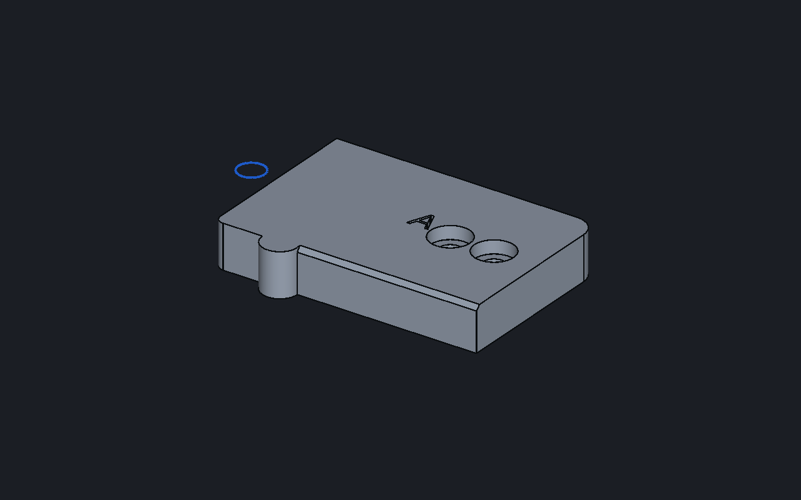

# GLUform

A tablet-first Android CAD app built on the open-source
[SolidCraft](https://github.com/tangency-labs/solidcraft) engine.

GLUform is a native Kotlin/Compose front end designed for touch. The geometry kernel, sketch
solver, parametric timeline and file import/export are SolidCraft's, compiled for Android and
reached through a small Rust bridge. None of SolidCraft's own UI, icons or branding is used.

*Desktop test render: an engine-built part drawn with the app's own shaders.*

## Status

**Early test build (0.1.0).** The engine bridge, the shaders and the app logic are tested on
desktop. The app has not yet been tested on a physical device, so expect touch-side bugs.

## Features

- **Viewport**: orbit, pan and pinch-zoom; standard views; perspective toggle; shaded, edges
  and see-through display.
- **Sketching**: line, rectangles, circles, arcs, polygon, slot, ellipse, spline, point and
  text; trim, extend, fillet, offset, mirror and project edge; dimensions and 12 constraint
  types; drag to move geometry.
- **Features**: extrude, revolve, sweep, loft, box, cylinder, sphere, cone, torus, hole,
  thread, rectangular and circular patterns, mirror, fillet, chamfer, shell, press/pull, offset
  face, draft, combine, split, move/copy, scale, colour and material, offset planes.
- **Editing**: a timeline (edit values, suppress, roll back, delete), parameters with
  formulas, a bodies and sketches browser, measure and mass properties.
- **Files**: open and save SolidCraft `.sc` designs; open or insert STEP, IGES, STL, 3MF and
  OBJ; export **STL** (three quality levels), **STEP**, 3MF, OBJ and GLB.
- **All commands**: a searchable list of every engine command (634 in SolidCraft 0.40), run
  with JSON parameters. Sheet metal, assemblies and surfaces are reachable this way for now.

Not there yet: section views in the viewport, and dedicated tools for sheet metal and assemblies.

## Layout

- `rust/` is `cadbridge`, a Rust library over `solidcraft-engine`:
  - `execute(command, json)` runs any engine command,
  - `scene()` returns bodies (triangles, normals, B-rep face per triangle, edges) and sketch curves,
  - `pick(ray)` finds the face, edge and vertex under a touch,
  - `src/host.rs` is `cadhost`, a desktop harness that runs JSON command scripts through the same code.
- `android/` is the app: `engine/` (JNI binding, scene reader), `gl/` (camera, renderer,
  gestures), `Cad.kt` (state and tool logic), `Tools.kt` (feature tools), `ui/` (Compose screens).

## Building

Requirements: Rust 1.95 or later with the `aarch64-linux-android` target, the Android SDK
(platform 35) and NDK, JDK 17 or later, Gradle 8.9 or later.

Clone SolidCraft **next to** this repository as `engine-src` (the bridge refers to it by path;
this project was built against v0.40.0):

    git clone https://github.com/tangency-labs/solidcraft.git ../engine-src

Build the engine bridge for Android and copy it into the app:

    cd rust
    export CARGO_TARGET_AARCH64_LINUX_ANDROID_LINKER=$NDK/toolchains/llvm/prebuilt/linux-x86_64/bin/aarch64-linux-android26-clang
    cargo build --release --lib --target aarch64-linux-android
    mkdir -p ../android/app/src/main/jniLibs/arm64-v8a
    cp target/aarch64-linux-android/release/libcadbridge.so ../android/app/src/main/jniLibs/arm64-v8a/

The engine is large: allow 8 GB of memory or more (`cargo build -j1` helps) and a long first build.

Build the app (set `sdk.dir` in `android/local.properties` or `ANDROID_HOME` first):

    cd ../android
    gradle :app:assembleRelease

The release build is signed with the Android debug key, so it installs for testing but is not
ready for a store listing.

Tests:

    cd rust && cargo build --bin cadhost && ./target/debug/cadhost run script.json
    cd android && GLUFORM_SCENE=/path/to/scene.bin gradle :app:testDebugUnitTest

(`scene.bin` is written by a `cadhost` script step `{"command": "@scenefile", "path": "..."}`.)

## Credits

Built on [SolidCraft](https://github.com/tangency-labs/solidcraft) (MIT OR Apache-2.0), an
independent open-source parametric CAD project. GLUform is not affiliated with it.
